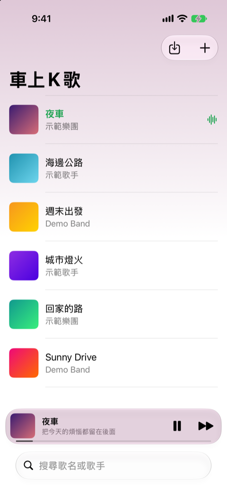
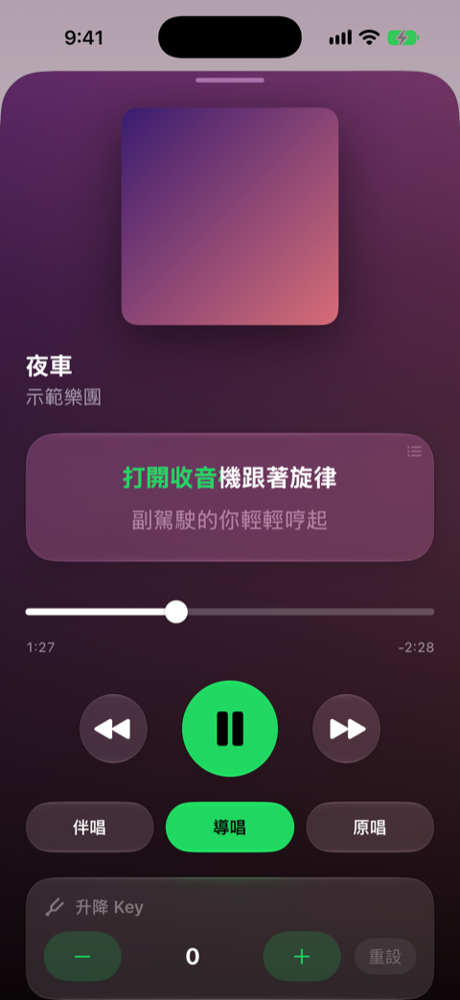
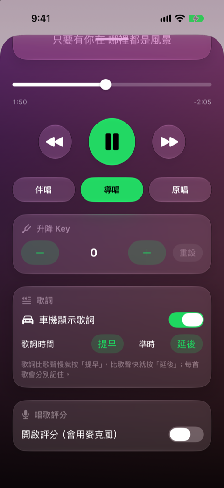
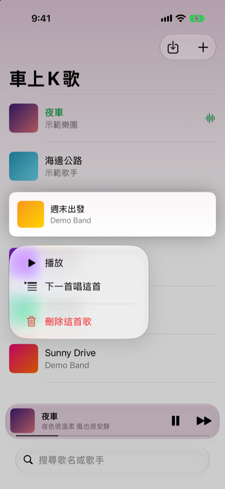
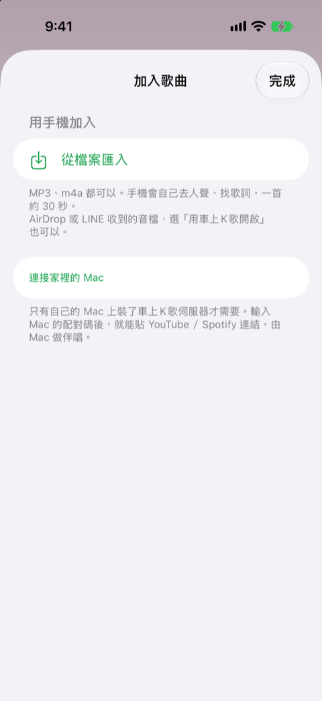
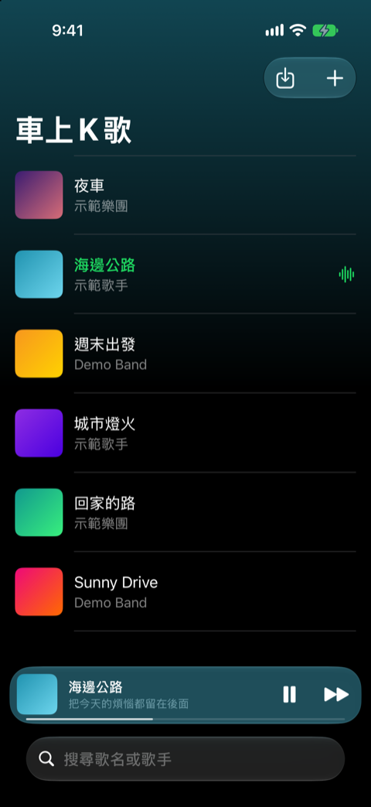

# 車上K歌

在車上用 iPhone 唱 KTV 的 App：去人聲的伴唱、一個字一個字變色的字幕、唱歌評分。iPhone 接上 CarPlay 後，車機會顯示正在唱的這一句。

- **匯入音檔，手機自己做**：MP3、m4a 等音檔匯入後，iPhone 用 Demucs 模型（Core ML，只用 CPU）去人聲、找歌詞，一首約 30 秒，不需要電腦。
- **（選用）家裡的 Mac 伺服器**：貼上 YouTube 或 Spotify 連結，由 Mac 下載、去人聲，再傳回手機。沒有配對過 Mac 的手機不會顯示這些功能。

安裝和使用方法見 [使用說明.md](使用說明.md)。

## 畫面

<table>
  <tr>
    <td align="center"><br>歌單和迷你播放器</td>
    <td align="center"><br>播放：歌詞一個字一個字變色</td>
    <td align="center"><br>升降 Key、歌詞時間、唱歌評分</td>
  </tr>
  <tr>
    <td align="center"><br>長按歌曲：播放、下一首、刪除</td>
    <td align="center"><br>加入歌曲：從檔案匯入</td>
    <td align="center"><br>深色模式：背景跟著封面變色</td>
  </tr>
</table>

畫面裡的歌曲是示範用的合成音檔、漸層封面和自己寫的歌詞。

## 下載專案

去人聲模型（約 57 MB）用 Git LFS 存放，請先安裝 Git LFS 再用 `git clone` 下載，並放在家目錄的 `CarKaraoke` 資料夾：

```bash
brew install git-lfs
git lfs install
git clone https://github.com/cz481511-cloud/Car_raoke.git ~/CarKaraoke
```

不要用 GitHub 的「Download ZIP」：ZIP 裡的模型檔只是一個小小的指標檔，App 會無法去人聲。

## 安裝前要改成自己的

這個專案沒有任何人的 Apple ID、Team ID 或電腦設定，每個人下載後要在自己的 Mac 上設定：

- `ios/project.yml` 的 `DEVELOPMENT_TEAM`：填自己 Apple ID 的 Team ID（或在 Xcode 的 Signing & Capabilities 選 Team）。
- Bundle ID `com.example.carkaraoke`：改成自己的，例如 `com.你的名字.carkaraoke`。改完在 `ios` 資料夾執行 `xcodegen` 重新產生專案。
- Mac 伺服器的配對碼：每台 Mac 第一次啟動時自己產生，不用設定。

## 安全

- Mac 伺服器只接受同一個區域網路和 Tailscale 裡的連線，其他地方連進來一律拒絕。
- 第一次連線要輸入 Mac 上的 6 位數配對碼；配對碼連續輸錯 10 次會暫停 15 分鐘。
- 配對碼和配對過的手機存在每台 Mac 自己的 `~/Library/Application Support/CarKaraoke/`，不在這個專案裡，每台 Mac 第一次啟動時會自己產生。
- 請不要在路由器把 8765 連接埠開放到網際網路。

## 注意

- 從 YouTube 下載可能違反 YouTube 的服務條款。做出來的歌只供自己使用，請不要散布。
- 歌詞來自 [LRCLIB](https://lrclib.net)，手機只送出歌名、歌手和歌的長度，聲音不會上傳。

## 授權

- 去人聲模型：Meta 的 [Demucs](https://github.com/facebookresearch/demucs)（htdemucs，MIT 授權），授權全文見 [THIRD_PARTY_LICENSES/demucs-LICENSE.txt](THIRD_PARTY_LICENSES/demucs-LICENSE.txt)。
- 本專案的程式：尚未選擇授權。
